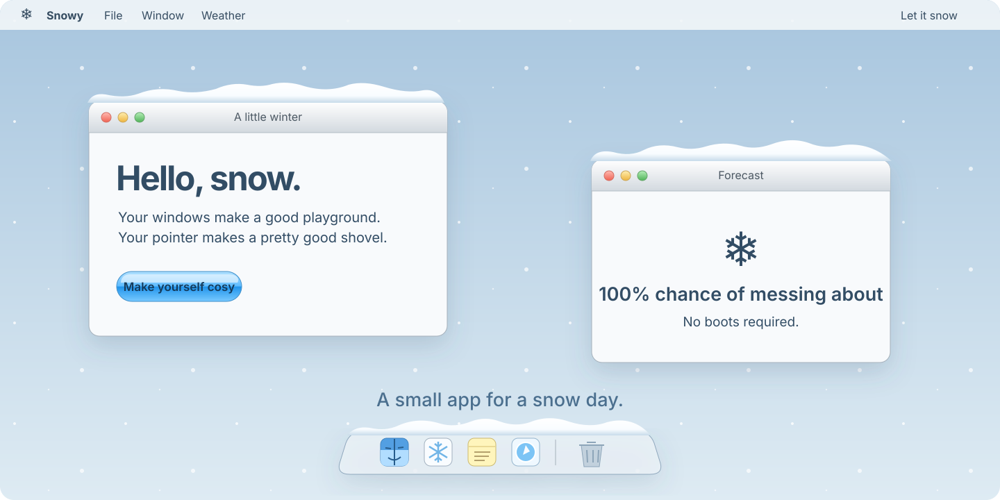

# Window Weather for macOS

Snow and autumn leaves on your windows. A native Mac app that lets the season settle on each window, widget, and the bottom Dock.

Sweep a pile with your pointer. Pick up a shovel. Make a little mess.



## Get it

The download page is [windowweather.bodhimooij.com](https://windowweather.bodhimooij.com). Open the Apple silicon DMG from a [release](https://github.com/BodhiMooij/window-weather/releases), then drag the app onto **Applications**. Finder shows it as **Window Weather**. Eject the disk image, then open Window Weather from Applications. On a fresh setup, three quick pages show how to sweep snow, adjust wind, and find the menu-bar controls. Skip or close the walkthrough at any time; it won’t reopen on later launches.

Requires **macOS 14 or later**. The current download is for Apple Silicon. Intel Macs can build from source. The 0.10.0 beta is signed locally and can trigger Gatekeeper’s malware-verification warning. If macOS blocks the copy you downloaded here, go to **System Settings → Privacy & Security → Open Anyway** after trying to open it.

When a compatible release is available, **Update** appears in blue near the bottom of the menu. Click it to download, install, and reopen Window Weather. To upgrade from 0.9.1 or earlier, quit Window Weather and replace it in Applications using the DMG once.

## On the menu

Click the menu-bar icon to make yourself comfortable. The switch chooses **Winter** or **Autumn**.

- Choose **Light**, **Steady**, or **Flurry**.
- Brush snow away with the **Glove**, or choose **Shovel** for a proper clear-out.
- Open **Wind…** and stretch or rotate the arrow to change its strength and direction.
- **Pause** the weather or **Clear Settled Snow** whenever you like.

Snow collects on window tops, widgets, Spotlight, and a bottom-positioned Dock. Moving windows push it around; closing Spotlight lets its uncovered snow fall. Side-positioned Docks are intentionally left out.

Choose **Open Window Weather…** in the menu to apply a wallpaper, select a pixel-art preset, or build your own desktop scene. Props catch snow and can slide when swept. In **Edit Scene**, place individual pieces and attach string lights to the desktop edges and widgets. Finder icon anchors are optional and require Accessibility access. The **Guide** includes **Replay Walkthrough**.

The desktop stays clickable. Window Weather reads public window bounds for snow, leaves, and widgets. Finder icon anchors use Accessibility only when enabled. Window Weather keeps your settings and imported wallpapers on your Mac and checks GitHub for signed updates.

## Build it yourself

You’ll need **Xcode 16 or later**, its Metal toolchain, and a Mac.

```sh
git clone https://github.com/BodhiMooij/window-weather.git
cd window-weather
./scripts/build-app.sh
open build/Snowy.app
```

The build script compiles the app and shaders, adds a local signature, and leaves the app in `build/`. It does not launch or install anything. If Xcode reports a missing Metal toolchain, install it from Xcode’s component settings first.

## A desktop in your browser

The [website](https://windowweather.bodhimooij.com) has its own movable windows, a bottom Dock, and snow you can push around. All downloads are pay what you want, including $0. Optional support uses [Polar hosted checkout](website/docs/payments.md).

Run it locally with **Node.js 22 or later**. No packages need installing.

```sh
npm --prefix website run dev
```

Open the address printed by the server. To make the static site, run `npm --prefix website run build`; the result goes into `website/dist/`. See the [Cloudflare deployment guide](website/docs/deployment.md) to publish it.

## A few rough edges

Window corners and some Dock bounds are estimates because macOS doesn’t expose every visible outline. Custom window shapes and system updates can need adjustments. The app has bounded simulation and rendering budgets, respects Low Power Mode and Reduced Motion, and pauses for sleep or fullscreen content. These are design choices, not a battery-life claim.

If something behaves oddly, [open an issue](https://github.com/BodhiMooij/window-weather/issues) with your macOS version, screen setup, Dock position, and steps to reproduce it.

## Contributing

```sh
swift test
npm --prefix website ci --ignore-scripts
npm --prefix website test
npm --prefix website run build
```

The tests run headlessly. They don’t open the app, inspect your desktop, or run benchmarks. See [CONTRIBUTING.md](CONTRIBUTING.md) for the project layout and release steps, and [the architecture notes](docs/architecture.md) for the physics and resource limits.

## Credits and license

Window Weather is by Bodhi Mooij. The readable, personal repository style was inspired by [Window Sweaters](https://github.com/saragordic/window-sweaters). Window Weather has its own implementation and artwork; it does not include Window Sweaters or JankyBorders code.

Code and original artwork use the [MIT license](LICENSE). The user-provided sound clip is excluded from that license.
